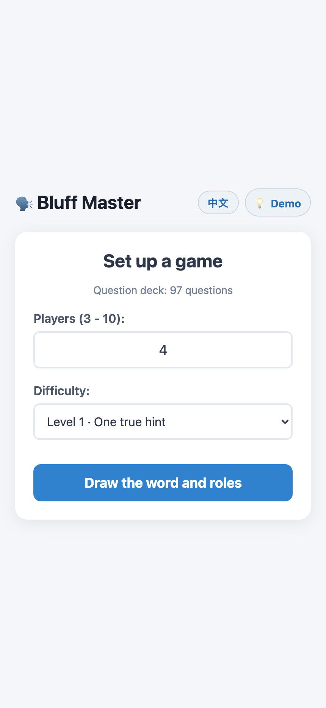
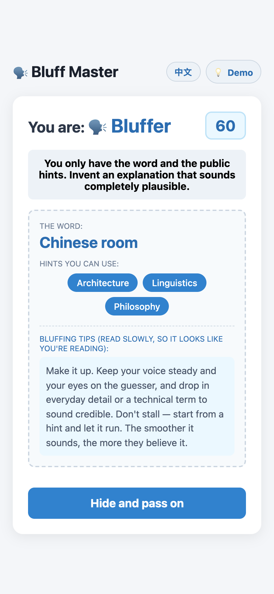
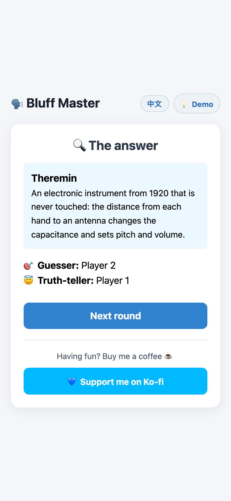

# 9upper · 吹水王

[](https://ko-fi.com/E2V52B1CCI)

**English** · [繁體中文](README.zh-TW.md)

A bluffing party game for 3 to 10 people sharing one phone. One player is handed the real definition of an obscure word. Everyone else has to invent one, out loud, and sound like they mean it. The guesser has to pick out the single person telling the truth.

<p>
  
  
  
</p>

## What you are playing

9upper (九upper, 吹水王) is a Hong Kong tabletop game about talking nonsense with a straight face. The box hands you a card of obscure trivia. One player reads the truth off it, everyone else makes something up, and the guesser tries to spot the liar.

This is that game running on a phone. There are no cards to print and nothing to install: open the page, type how many people are playing, and pass the phone round the table. 97 questions come built in, and they play differently each time because the bluffing does the work.

## How a round works

1. Set the player count and difficulty, then draw the word and deal the roles.
2. Everyone reads the word and its category hints together. This is the one part of the round where nothing is hidden.
3. Pass the phone. Each player taps to see only their own card, then hides it again for the next person.
4. A bluffer gets a 60-second clock to read their hints and think of something. The truth-teller reads the real definition.
5. The guesser picks someone to start. Going round the table, everyone explains what the word means.
6. The guesser says who they believe, then you reveal the answer and find out who was lying.

There are three roles, dealt fresh every round:

| Role | What they get | What they do |
| --- | --- | --- |
| 🎯 Guesser | The word and the public hints | Says nothing, listens, picks the truth-teller |
| 😇 Truth-teller | The real definition | Explains it well enough to be believed |
| 🗣️ Bluffer | The word and the public hints | Invents a definition that sounds real |

## Scoring at the table

The app keeps no score, so the table decides. The usual rules from the box:

- Guesser scores if they name the truth-teller.
- Truth-teller scores if the guesser names them.
- A bluffer scores if the guesser picks them instead.

## Difficulty

| Level | What the table sees | When to pick it |
| --- | --- | --- |
| 1 · One true hint | A single honest category | First game with a new group |
| 2 · One true hint + two decoys | Three categories, shuffled, only one honest | The usual choice; the decoys give bluffers room |
| 3 · No hints | Nothing at all | Everyone has played before and wants a mess |

## Language

繁體中文 and English are both built in, and all 97 questions are translated, not just the buttons. Switch with the button at the top right; the choice is remembered in the browser.

## Play it now

No build step, no dependencies, nothing to install for a single device:

```
git clone https://github.com/incensestudio852/9upper.git
cd 9upper
open index.html
```

To play on phones, serve the same folder over your local network:

```
python3 -m http.server 8000
```

Then load `http://<your-computer-ip>:8000` on the phone. Everything runs in the browser, and it works offline apart from the tip panel at the end.

## Questions

The 97 entries are hand-written. Each one has a word, one true hint, two decoy hints and a real definition. Four rules keep the deck playable:

1. The word should be obscure, and its literal meaning should point the wrong way.
2. Hints should be broad categories, not giveaways.
3. Every entry needs one true hint, two decoy hints and a definition a normal person can say out loud.
4. Skip anything that reads as crude or gross. It kills the round.

To add one, open `app.js` and add an entry to `quizBank`. Then open `quiz-en.js` and add the English word and definition under the Chinese word, plus any new category to `hintEn`. If a translation is missing the game falls back to Chinese instead of breaking.

Pull requests with new questions are welcome, especially the ones that are hard to bluff about.

## Files

| File | What is in it |
| --- | --- |
| `index.html` | Six screens and the markup |
| `app.js` | Game flow, role dealing, countdown, the 97-question deck |
| `lang.js` | Interface strings for both languages |
| `quiz-en.js` | English words, definitions and hint categories |
| `style.css` | Styling |
| `docs/` | Screenshots used in these READMEs |

## Support

The game is free and stays free. If your table had a good night, there is a coffee button on the last screen of every round, or use the badge above.

## License

MIT, see [LICENSE](LICENSE). The game format comes from the 9upper tabletop game; the question deck here was written for this version, and every term is a real concept from history, science or folklore.
