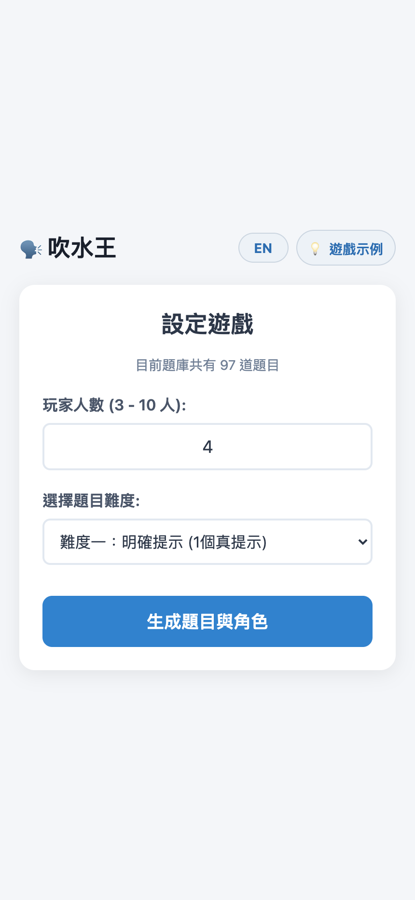
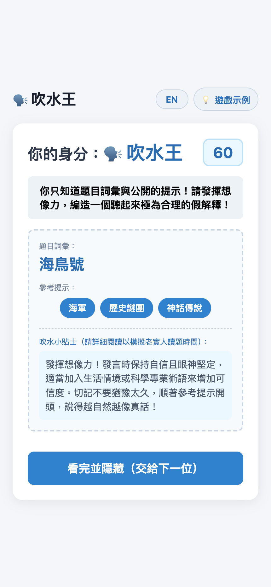
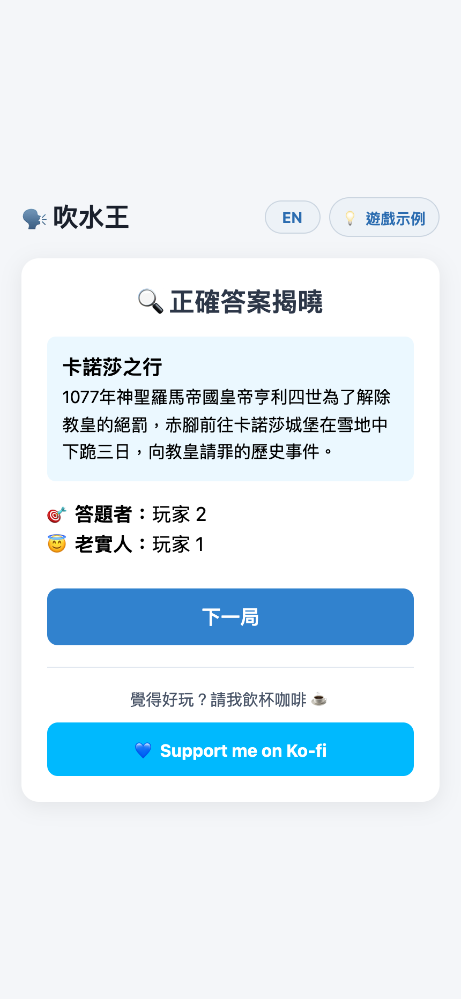

# 9upper · 吹水王

[](https://ko-fi.com/E2V52B1CCI)

[English](README.md) · **繁體中文**

一部手機，三到十個人。一人拿到冷門詞彙的真解釋，其餘各憑本事吹水。答題者要認出唯一講真話的人。

<p>
  
  
  
</p>

## 這個遊戲是什麼

「9upper」（九upper、吹水王）是香港的派對桌遊。核心一句話講完：一個人在講真話，其他人都在吹水，答題者要找出老實人。

桌面上那副牌，這裡搬進手機。不用印卡，不用安裝，開網頁、填人數、手機傳一圈就開局。內建 97 道題目。同一題換一桌人，玩起來完全不同。

## 一局怎樣走

1. 設定人數與難度，抽題、派身分。
2. 全桌一起看題目詞彙與提示。這一刻沒有秘密。
3. 手機開始傳。每人點開自己的身分卡，看完交下一位。
4. 吹水王有 60 秒讀提示、想對白。老實人讀真解釋。
5. 答題者指定誰先講，全桌輪流解釋這個詞。
6. 答題者指認老實人，然後揭曉答案。

三種身分，每局重派：

| 身分 | 看到什麼 | 要做什麼 |
| --- | --- | --- |
| 🎯 答題者 | 題目與公開提示 | 不講話，專心聽，最後指認 |
| 😇 老實人 | 真實解釋 | 講得順，講得可信 |
| 🗣️ 吹水王 | 題目與公開提示 | 編一個像真的解釋 |

## 計分（檯面自己記）

程式不計分，分數由檯面記。常見玩法：

- 答題者指中老實人，答題者得分。
- 老實人被指中，老實人得分。
- 答題者指錯人，被指中的吹水王得分。

## 難度

| 難度 | 檯面看到什麼 | 幾時用 |
| --- | --- | --- |
| 一 · 一個真提示 | 一個真分類 | 新朋友第一次玩 |
| 二 · 一真兩假 | 三個分類打亂，只有一個真 | 最常用；假提示給吹水王留空間 |
| 三 · 完全無提示 | 什麼都沒有 | 老手想熱鬧一下 |

## 語言

中英雙語，97 道題目連解釋都翻了，不只是按鈕。右上角一按即換，瀏覽器會記住你的選擇。

## 即刻玩

單機玩不用伺服器：

```
git clone https://github.com/incensestudio852/9upper.git
cd 9upper
open index.html
```

要用手機同桌玩，在同一個資料夾開本機伺服器：

```
python3 -m http.server 8000
```

手機開 `http://<電腦IP>:8000` 就見到。全部在瀏覽器跑；除了最後的贊助面板，離線也能玩。

## 題庫

97 題全部手寫。每題有詞彙、一個真提示、兩個假提示、一段真實簡介。出題守四條規矩：

1. 詞彙要冷門，字面意思要誤導人。
2. 提示寫大範圍分類，不要直接寫成答案。
3. 真提示、假提示、簡介，一樣都不能少。
4. 避開字面帶色情或噁心的詞。

加題做法：`app.js` 的 `quizBank` 加一筆，再到 `quiz-en.js` 補上英文詞與解釋，新分類加進 `hintEn`。缺翻譯時會退回中文，遊戲不會壞掉。

歡迎 PR 投稿新題目，特別是難吹的題。

## 檔案

| 檔案 | 內容 |
| --- | --- |
| `index.html` | 六個畫面與版面 |
| `app.js` | 遊戲流程、派身分、倒數、97 題題庫 |
| `lang.js` | 中英文介面文字 |
| `quiz-en.js` | 英文詞彙、解釋、提示分類 |
| `style.css` | 樣式 |
| `docs/` | README 用的截圖 |

## 贊助

遊戲免費，以後也免費。一局玩完若盡興，最後一頁有咖啡按鈕，也可以點上面的徽章。

## 授權

MIT，見 [LICENSE](LICENSE)。玩法來自 9upper 桌遊；本版題庫為此版本新寫，詞彙都是真實的歷史、科學與民俗概念。
